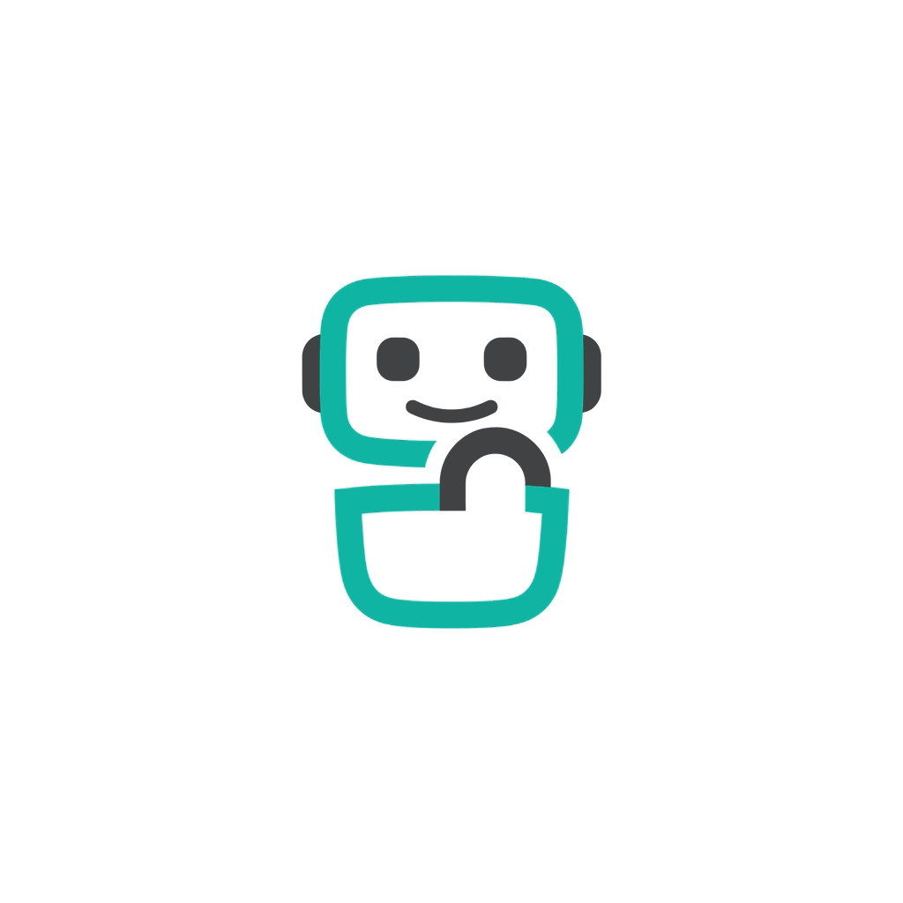
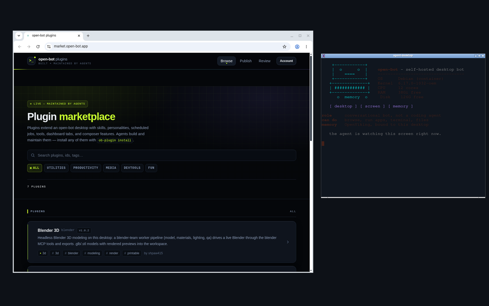

<div align="center">



# open-bot

**A self-hosted AI bot with a real Linux desktop it can see and operate.**

Not a coding agent — a conversational bot with a screen, a shell, and a memory,
working for every user in your household or team, on your hardware.

[Get started](#quick-start) · [Documentation](https://docs.open-bot.app) · [Plugin marketplace](https://market.open-bot.app)


<br/>

<p align="center">
  <br/>
  <sub>Every user gets an isolated Linux desktop. The bot sees the screen and drives it — browser, native apps, terminal — on your behalf.</sub>
</p>

</div>

## How it works

**Browser → control plane (`:8787`) → desktop (`:4096`) ↔ memory (`:1933`)**

- **Control plane** — one Bun server in Docker: sqlite, dashboard API, and orchestration of per-user containers.
- **Desktop** — the user's agent runtime plus a **thread screen**: a virtual display (Xvfb + VNC + CDP) with a browser and native apps the bot can see and operate.
- **OpenViking** — per-user long-term memory, searched semantically before every turn.

*OpenCode is only the runtime inside the desktop container; the control plane never reads your host OpenCode config.*

<p align="center">
  <br/>
  <sub>One Docker host: the control plane starts a desktop and an OpenViking container per user.</sub>
</p>

## Features

| Feature | What you get |
| --- | --- |
| 💬 **Chat + voice** | Streaming replies, personas, `@projects` / `@reports` mentions, hold-to-speak, read-aloud, image / video / 3D generation. |
| 🖥️ **Thread screen** | The bot's eyes and hands: it browses, installs and launches native apps, and drives a real desktop per thread. |
| 🧠 **OpenViking memory** | Long-term memory per desktop — preferences, project docs, and corrections survive across sessions. |
| 🔌 **Plugins + marketplace** | Manifest-driven extensions (skills, tools, cron, dashboard tabs) reviewed automatically before publishing. |
| ⏰ **Cron + reports** | Scheduled prompts run as hidden sessions; the agent files product defects and plugin friction into review queues. |
| 👥 **Multi-user** | Isolated desktop, memory, keys, and usage per user behind one dashboard. |

## Quick start

```sh
bun run setup
```

The wizard writes `deploy/.env`, can install dependencies, build images, pull
OpenViking, and start Compose — then prints the URL (default port `8787`).
It never asks for an AI provider; models connect later, in the dashboard.

1. **First login** — `admin@localhost` / `changeme`; you pick new credentials right away.
2. **Memory models** — set OpenViking embedding + VLM on the Config page
   ([Cloudflare Workers AI walkthrough](docs/openviking-setup.md)).
3. **Chat models** — connect providers on the Config page's Providers tab.

### Updating

```sh
bun run update
```

Rebuilds desktop images, recreates the control container, and restarts running
desktops — volumes are kept, so browser logins and installed packages survive.
Add `-- --pull-viking` to also pull OpenViking.

## Documentation

| | |
| --- | --- |
| [Setup](https://docs.open-bot.app/docs/setup) | Install, first login, providers |
| [Architecture](https://docs.open-bot.app/docs/architecture) | How the pieces fit |
| [Configuration reference](https://docs.open-bot.app/docs/configuration) | Every env var and setting |
| [Plugin system](https://docs.open-bot.app/docs/plugins) · [Marketplace](https://docs.open-bot.app/docs/marketplace) | Writing and publishing plugins |
| [Voice](https://docs.open-bot.app/docs/voice) · [Native apps](https://docs.open-bot.app/docs/native-apps) · [Media vault](https://docs.open-bot.app/docs/media-vault) | Feature guides |
