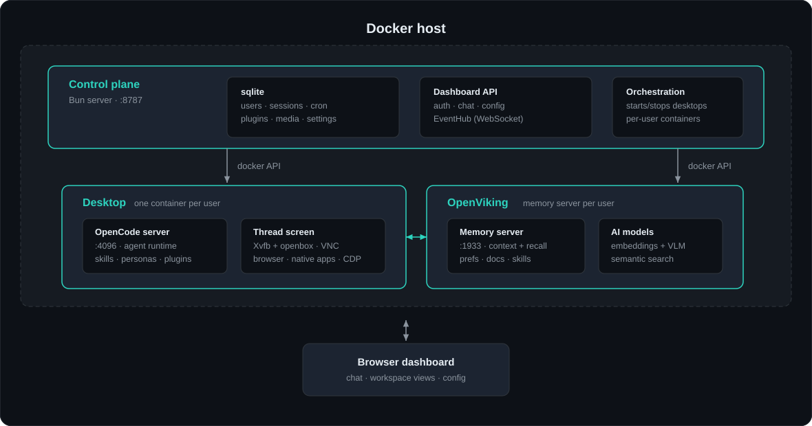
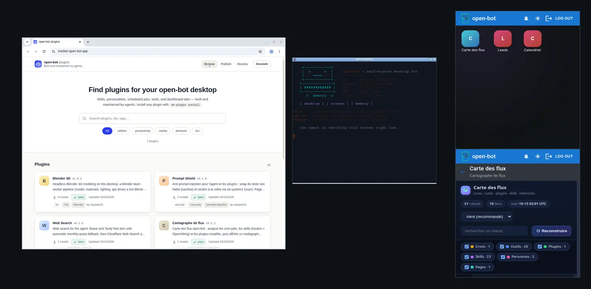

<div align="center">


# open-bot

**The WordPress of the AI workstation.**

A self-hosted AI bot with a real Linux desktop it can see and operate — not a
coding agent, but a conversational bot with a screen, a shell, and a memory,
working for every user in your household or team, on your hardware.

[Get started](#quick-start) · [Documentation](https://docs.open-bot.app) · [Plugin marketplace](https://market.open-bot.app)


</div>

## How it works

**Browser → control plane (`:8787`) → desktop (`:4096`) ↔ memory (`:1933`)**

- **Control plane** — one Bun server in Docker: sqlite, dashboard API, and orchestration of per-user containers.
- **Desktop** — the user's agent runtime plus a **thread screen**: a virtual display (Xvfb + VNC + CDP) with a browser and native apps the bot can see and operate.
- **OpenViking** — per-user long-term memory, searched semantically before every turn.

*OpenCode is only the runtime inside the desktop container; the control plane never reads your host OpenCode config.*

<p align="center">
  <br/>
  <sub>One Docker host: the control plane starts a desktop and an OpenViking container per user.</sub>
</p>

## Features

| Feature | What you get |
| --- | --- |
| 💬 **Chat + voice** | Streaming replies, personas, `@projects` / `@reports` mentions, hold-to-speak, read-aloud, image / video / 3D generation. |
| 🖥️ **Thread screen** | The bot's eyes and hands: it browses, installs and launches native apps, and drives a real desktop per thread. |
| 🧠 **OpenViking memory** | Long-term memory per desktop — preferences, project docs, and corrections survive across sessions. |
| 🔌 **[Plugins + marketplace](#everything-is-a-plugin)** | Manifest-driven extensions (skills, tools, cron, dashboard tabs) reviewed automatically before publishing. |
| ⏰ **Cron + reports** | Scheduled prompts run as hidden sessions; the agent files product defects and plugin friction into review queues. |
| 👥 **Multi-user** | Isolated desktop, memory, keys, and usage per user behind one dashboard. |

<p align="center">
  <br/>
  <sub>A real desktop, captured live: the bot browses the plugin marketplace while its terminal reports for duty — and the Apps home screen on mobile shows every installed plugin, one tap from its live dashboard.</sub>
</p>

## Everything is a plugin

WordPress turned websites into a plugin ecosystem; open-bot turns AI labor into
one. It ships almost no hardcoded behavior — skills, tools, schedules,
personalities, even live dashboard apps are **plugins**. One JSON manifest
describes the whole extension: the same system that publishes to the
marketplace is the one you'd use for your own private tooling.

```jsonc
{
  "id": "web-search",
  "name": "Web Search",
  "version": "1.0.0",
  "description": "Web search with automatic quota fallback",
  "author": "you",
  "repo": "github.com/you/open-bot-web-search",
  "category": "productivity",
  "skills": [{ "name": "search", "description": "…", "body": "…" }],
  "tools": [{ "name": "web_search", "content": "…" }],
  "configs": [{ "key": "engine", "type": "enum", "options": ["brave", "tavily"] }],
  "permissions": { "vaultCreate": ["brave"] },
  "cron": [{ "name": "morning-digest", "cronExpr": "0 9 * * *", "run": "prompt", "message": "…" }],
  "dashboard": { "tabs": [{ "kind": "page", "dataUrl": "/stats.json", "pollSeconds": 60 }] },
  "opencode": { "agentsMd": "Always answer in the user's language." }
}
```

**One manifest can touch every layer:**

| Surface | What a plugin adds |
| --- | --- |
| 🧩 `skills[]` · `personas[]` | New behaviors and personalities, loaded into the agent and its OpenViking memory. |
| 🛠️ `tools[]` · `files[]` · `setup.commands` | Desktop CLIs and payload scripts, installed to `/usr/local/bin` — optionally via root setup. |
| ⏰ `cron[]` | Scheduled prompts or scripts that run as hidden sessions and post results back. |
| 📊 `dashboard.tabs[]` · `dashboard.pages` | A live app or polled cards inside the dashboard — plus an optional public webhook endpoint with optional secret. |
| 🤖 `opencode.*` | Register new agent workers, patch tool access on existing ones, inject standing instructions. |
| 🔑 `configs[]` + vault permissions | Typed settings and secret keys, filled from the dashboard and re-synced on rotation. |
| 🪝 `hooks[]` · notifications | React to `session.idle` / `thread.created`, or push toasts to the dashboard. |

**Modularity with guardrails:**

- Every marketplace publish runs an **automated security review** (manifest,
  payload files, and config guide) before the version is approved for install.
- Installs are consented and logged; **uninstall reverses everything** through
  the recorded install log. Disable goes deep — pauses cron, unloads skills,
  drops vault config — and enable restores from the manifest snapshot.
- Desktop recreates re-apply plugin setup automatically, so installs survive
  updates; secrets re-sync when you rotate keys.
- Local development needs no publish: `ob-plugin install --path ./my-plugin`.

```sh
ob-plugin new my-plugin   # scaffold + schema
ob-plugin publish         # security review, then live on the marketplace
ob-plugin install web-search
```

Browse the marketplace at [market.open-bot.app](https://market.open-bot.app),
or read the [plugin system](https://docs.open-bot.app/docs/plugins) and
[marketplace](https://docs.open-bot.app/docs/marketplace) guides.

## Quick start

```sh
bun run setup
```

The wizard writes `deploy/.env`, can install dependencies, build images, pull
OpenViking, and start Compose — then prints the URL (default port `8787`).
It never asks for an AI provider; models connect later, in the dashboard.

1. **First login** — `admin@localhost` / `changeme`; you pick new credentials right away.
2. **Memory models** — set OpenViking embedding + VLM on the Config page
   ([Cloudflare Workers AI walkthrough](docs/openviking-setup.md)).
3. **Chat models** — connect providers on the Config page's Providers tab.

### Updating

```sh
bun run update
```

Rebuilds desktop images, recreates the control container, and restarts running
desktops — volumes are kept, so browser logins and installed packages survive.
Add `-- --pull-viking` to also pull OpenViking.

## Documentation

| | |
| --- | --- |
| [Setup](https://docs.open-bot.app/docs/setup) | Install, first login, providers |
| [Architecture](https://docs.open-bot.app/docs/architecture) | How the pieces fit |
| [Configuration reference](https://docs.open-bot.app/docs/configuration) | Every env var and setting |
| [Plugin system](https://docs.open-bot.app/docs/plugins) · [Marketplace](https://docs.open-bot.app/docs/marketplace) | Writing and publishing plugins |
| [Voice](https://docs.open-bot.app/docs/voice) · [Native apps](https://docs.open-bot.app/docs/native-apps) · [Media vault](https://docs.open-bot.app/docs/media-vault) | Feature guides |
